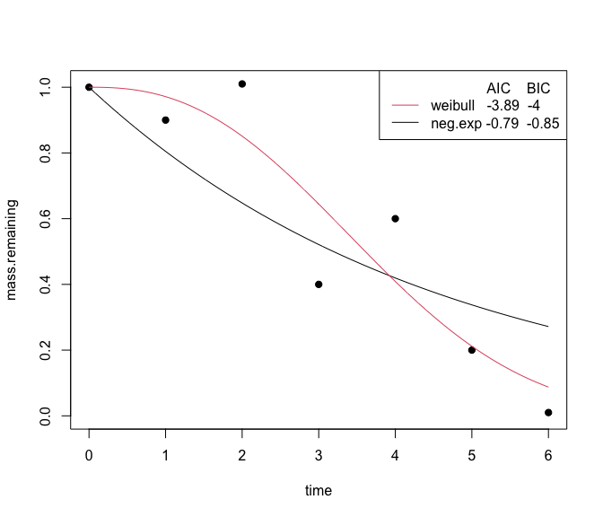
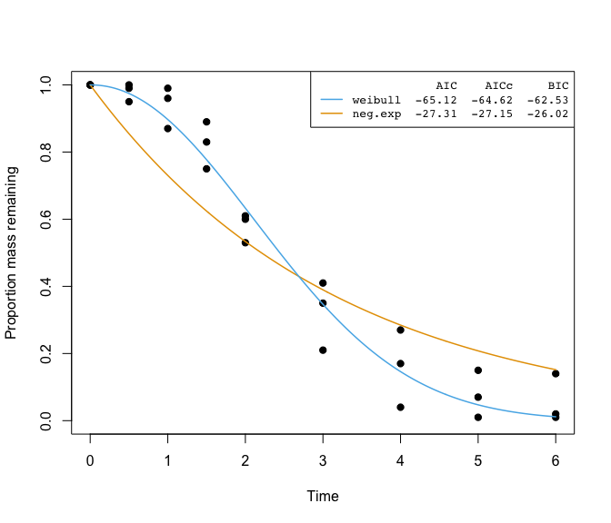
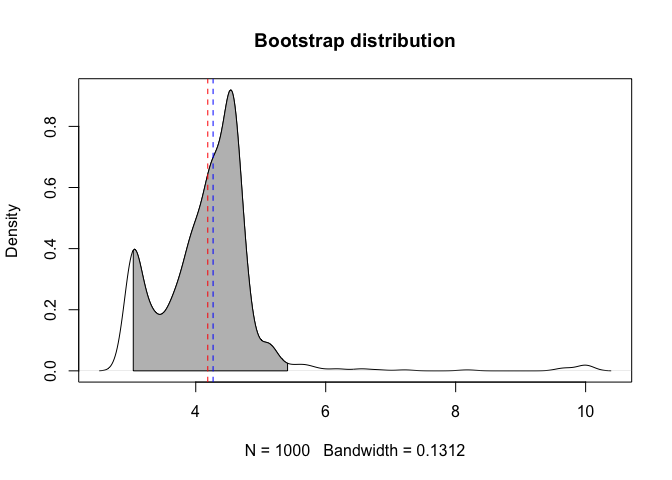
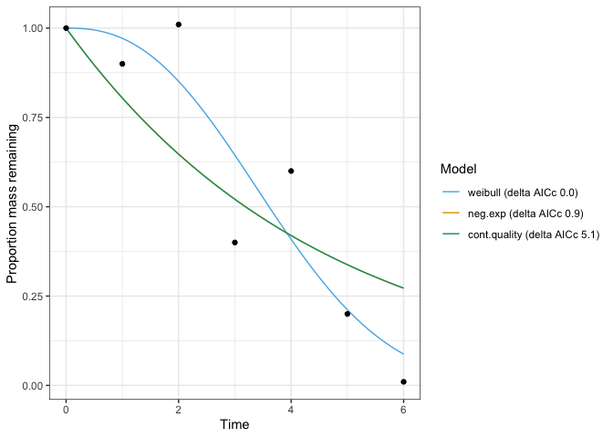

<!-- README.md is generated from README.Rmd. Please edit that file -->

# litterfitter 

> R package for fitting and testing alternative models for single cohort
> litter decomposition data

<!-- badges: start -->

[](https://github.com/traitecoevo/litterfitter/actions/workflows/R-CMD-check.yaml)
[](https://doi.org/10.1111/2041-210X.12138)
[](https://cran.r-project.org/package=litterfitter)
<!-- badges: end -->

### Installation

Install the released version from CRAN:

``` r
install.packages("litterfitter")
```

or the development version from GitHub:

``` r
# install.packages("remotes")
remotes::install_github("traitecoevo/litterfitter")
```

### Getting started

At the moment there is one key function which is `fit_litter` which can
fit 6 different types of decomposition trajectories. Note that the
fitted object is a `litfit` object

``` r
fit <- fit_litter(
  time = c(0, 1, 2, 3, 4, 5, 6),
  mass.remaining = c(1, 0.9, 1.01, 0.4, 0.6, 0.2, 0.01),
  model = "weibull",
  iters = 500
)

class(fit)
```

You can visually compare the fits of different non-linear equations with
the `plot_multiple_fits` function:

``` r
plot_multiple_fits(
  time = c(0, 1, 2, 3, 4, 5, 6),
  mass.remaining = c(1, 0.9, 1.01, 0.4, 0.6, 0.2, 0.01),
  model = c("neg.exp", "weibull"),
  iters = 500
)
```



Calling `plot` on a `litfit` object will show you the data, the curve
fit, and even the equation, with the estimated coefficients:

``` r
plot(fit)
```



The summary of a `litfit` object will show you some of the summary
statistics for the fit.

    #> Summary of litFit object
    #> Model type: weibull 
    #> Number of observations:  7 
    #> Parameter fit (beta): 4.19
    #> Parameter fit (alpha): 2.47
    #> Time to 50% mass loss: 3.61 
    #> Implied steady state litter mass: 3.71 in units of yearly input 
    #> AIC:  -3.8883 
    #> AICc:  -0.8883 
    #> BIC:  -3.9965

Bootstrapping shows the uncertainty in the parameter estimates and in
the fitted curve:

``` r
boot <- bootstrap_parameters(fit, nboot = 500)
plot(fit, boot = boot)
```



### Comparing models and tidy output

`fit_litter_all()` fits several models at once, and `glance()` gives a
model comparison table. `tidy()`, `glance()` and `augment()` return
results as data frames for further analysis or custom plots:

``` r
fits <- fit_litter_all(
  time = c(0, 1, 2, 3, 4, 5, 6),
  mass.remaining = c(1, 0.9, 1.01, 0.4, 0.6, 0.2, 0.01),
  models = c("neg.exp", "weibull", "cont.quality"),
  iters = 500
)
glance(fits)[, c("fit", "nparams", "AICc", "delta_AICc", "time_to_50")]
#>            fit nparams         AICc delta_AICc time_to_50
#> 1      weibull       2 -0.888323046  0.0000000   3.608246
#> 2      neg.exp       1  0.007982282  0.8963053   3.191964
#> 3 cont.quality       2  4.234370138  5.1226932   3.187782
```

With ggplot2 installed, `autoplot()` draws fits, model comparisons and
bootstrap distributions as ggplot objects:

``` r
library(ggplot2)
autoplot(fits) + theme_bw()
```



### Element dynamics

`fit_element()` fits how the proportion of an element remaining
(e.g. nitrogen) changes as mass is lost, using the model of Parton et
al. (2007). See the vignette for details.
