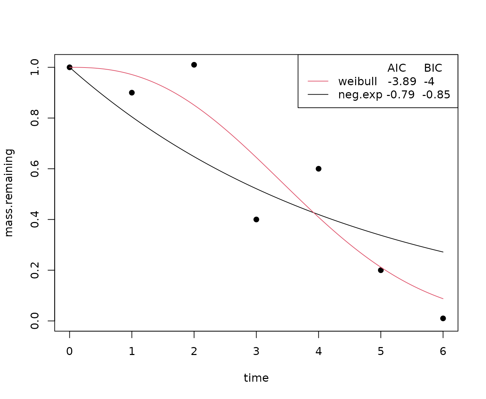

# litterfitter

This vignette provides an overview of the main functions in
`litterfitter`

### Getting started

``` r

library(litterfitter)
set.seed(1)
```

The key function is `fit_litter`, which can fit 6 different types of
decomposition trajectories: `neg.exp`, `weibull`, `discrete.parallel`,
`discrete.series`, `cont.quality` and `neg.exp.limit` (see
[`?fit_litter`](https://traitecoevo.github.io/litterfitter/reference/fit_litter.md)).
The fitted object is a `litfit` object

``` r

fit <- fit_litter(
  time = c(0, 1, 2, 3, 4, 5, 6),
  mass.remaining = c(1, 0.9, 1.01, 0.4, 0.6, 0.2, 0.01),
  model = "weibull",
  iters = 500
)

class(fit)
```

You can visually compare the fits of different non-linear equations with
the `plot_multiple_fits` function:

``` r

plot_multiple_fits(
  time = c(0, 1, 2, 3, 4, 5, 6),
  mass.remaining = c(1, 0.9, 1.01, 0.4, 0.6, 0.2, 0.01),
  model = c("neg.exp", "weibull"),
  iters = 500
)
```



Calling `plot` on a `litfit` object will show you the data, the curve
fit, and even the equation, with the estimated coefficients:

``` r

plot(fit)
```


The summary of a `litfit` object will show you some of the summary
statistics for the fit.

    #> Summary of litFit object
    #> Model type: weibull 
    #> Number of observations:  7 
    #> Parameter fit (beta): 4.19
    #> Parameter fit (alpha): 2.47
    #> Time to 50% mass loss: 3.61 
    #> Implied steady state litter mass: 3.71 in units of yearly input 
    #> AIC:  -3.8883 
    #> AICc:  -0.8883 
    #> BIC:  -3.9965

From the `litfit` object you can then see the uncertainty in the
parameter estimate by bootstrapping

``` r

post <- bootstrap_parameters(fit, nboot = 500)
plot(post)
```


and summarise the bootstrap distribution of each parameter (and of the
implied steady state) as a mean with quantiles:

``` r

summary(post)
#>                  mean     2.5%      50%     97.5%
#> beta         4.145287 3.026793 4.250955  5.150702
#> alpha        4.236101 1.109011 2.653679 10.000000
#> steady_state 3.801138 2.873050 3.790378  4.900035
```

### Working with fitted models

Printing a `litfit` object gives the fitted parameters and information
criteria, and the standard extractor functions work as you would expect:

``` r

fit
#> litfit object: model weibull fit to 7 observations
#> Parameters:
#>  beta alpha 
#> 4.185 2.471 
#> logLik: 3.944   AIC: -3.888   AICc: -0.888   BIC: -3.997
coef(fit)
#>     beta    alpha 
#> 4.185250 2.470686
residuals(fit)
#> [1]  0.00000000 -0.07131745  0.15897526 -0.24450225  0.19105538 -0.01185021
#> [7] -0.07760268
predict(fit, newdata = c(7, 8, 9))
#> [1] 0.028335593 0.007037663 0.001319326
```

Two quantities that are often of ecological interest can be derived from
any fit: the time until a given proportion of mass remains, and the
implied steady-state litter mass (in units of yearly input):

``` r

time_to_prop_mass_remaining(fit, threshold.mass = 0.5)
#> [1] 3.608246
steady_state(fit)
#>  weibull 
#> 3.712382
```

### Comparing models

Because `litfit` objects have a `logLik` method, the base R functions
[`AIC()`](https://rdrr.io/r/stats/AIC.html) and
[`BIC()`](https://rdrr.io/r/stats/AIC.html) can be used to compare
several models fit to the same data. Here we fit a set of models to the
`pineneedles` data that ships with the package:

``` r

data(pineneedles)
models <- c("neg.exp", "weibull", "discrete.parallel", "cont.quality")
fits <- lapply(models, function(m) {
  fit_litter(
    time = pineneedles$Year,
    mass.remaining = pineneedles$Mass.remaining,
    model = m, iters = 500, quiet = TRUE
  )
})
names(fits) <- models

data.frame(
  model = models,
  df = sapply(fits, function(f) attr(logLik(f), "df")),
  AIC = sapply(fits, AIC),
  AICc = sapply(fits, function(f) f$fitAICc),
  BIC = sapply(fits, BIC),
  row.names = NULL
)
#>               model df       AIC        AICc       BIC
#> 1           neg.exp  1 -16.39479 -15.3947904 -16.60303
#> 2           weibull  2 -14.91789 -10.9178902 -15.33437
#> 3 discrete.parallel  3 -12.45438  -0.4543834 -13.07910
#> 4      cont.quality  2 -14.38485 -10.3848483 -14.80133
```

For two fits you can also call
[`AIC()`](https://rdrr.io/r/stats/AIC.html) directly,
e.g. `AIC(fits$neg.exp, fits$weibull)`. The small-sample corrected AICc
is stored in each fit as `fitAICc`.

Note that with only a handful of observations the more complex models
are often poorly identified; see Cornwell & Weedon (2013) for a
discussion.
