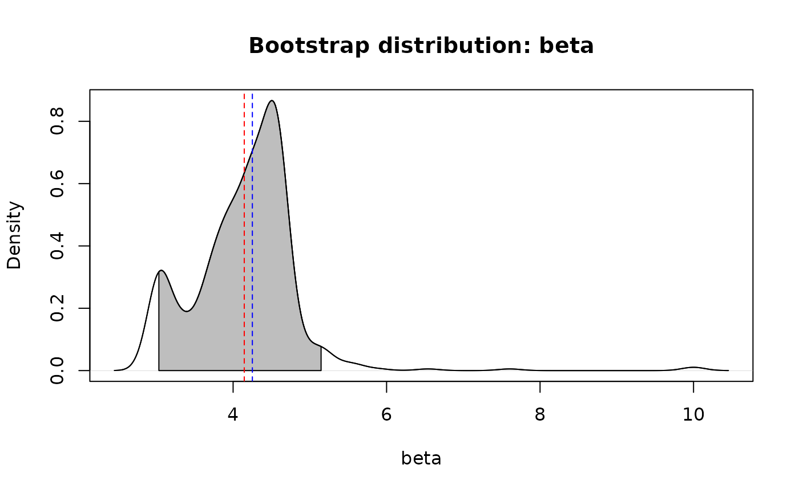
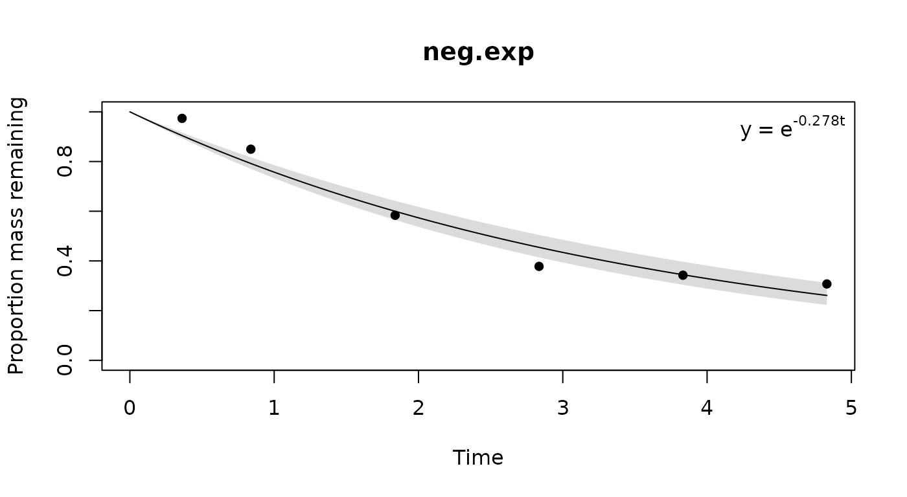
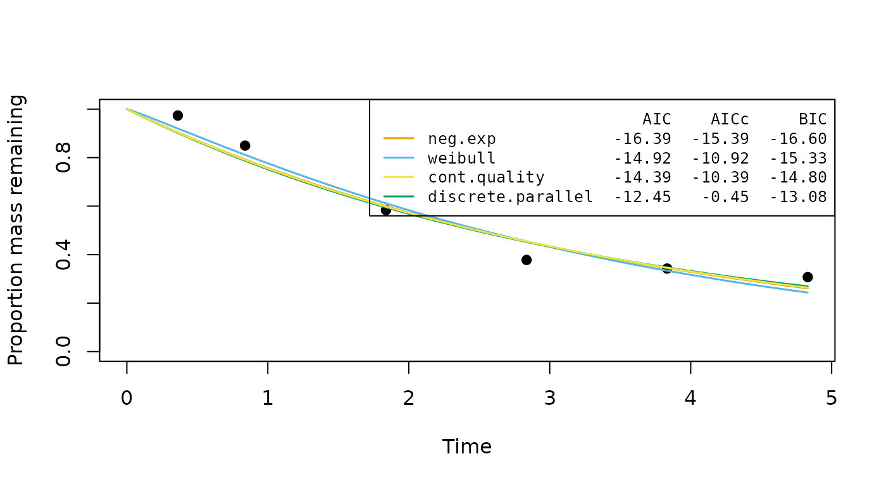
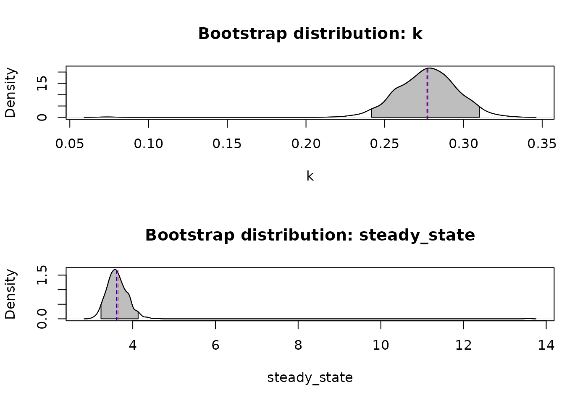
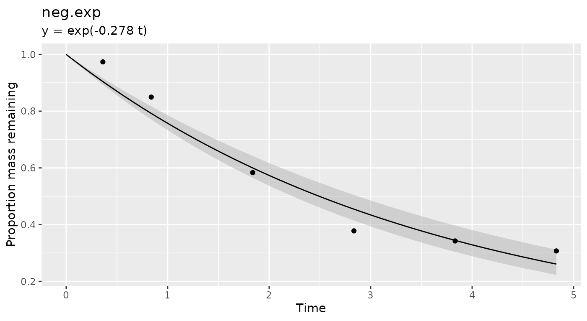
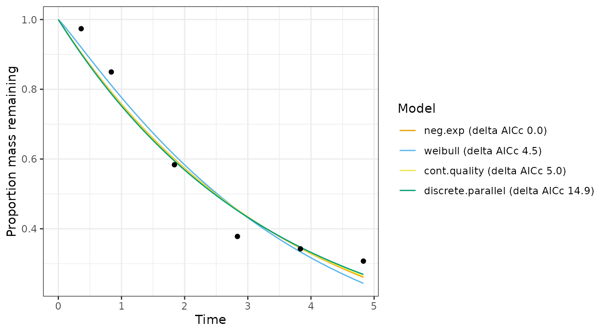
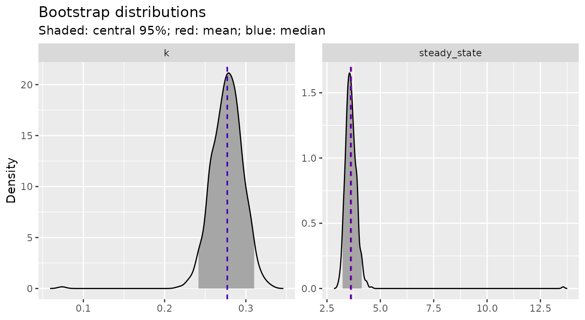
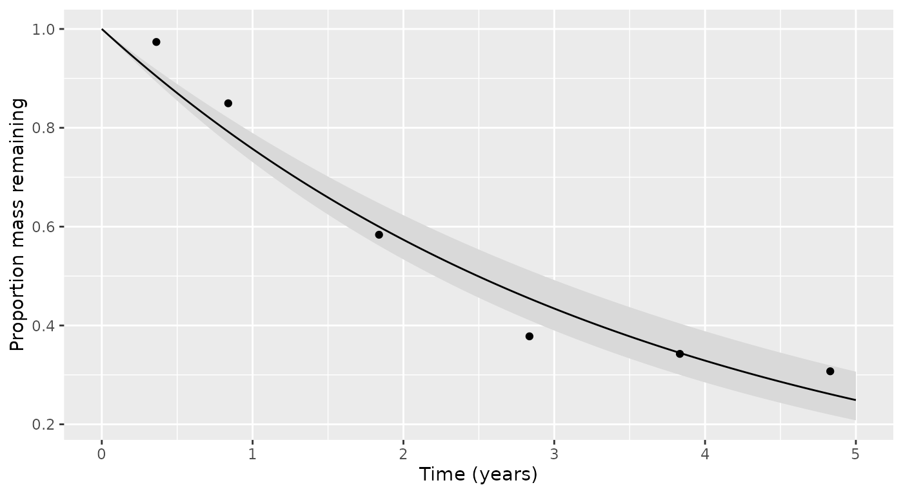
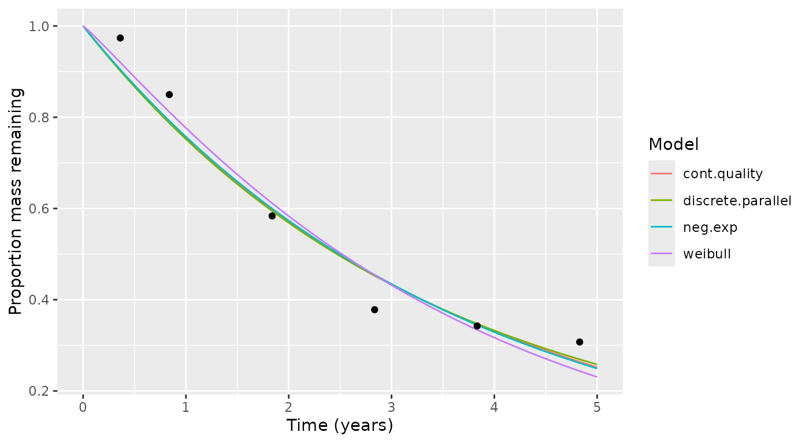

# litterfitter

This vignette provides an overview of the main functions in
`litterfitter`

### Getting started

``` r

library(litterfitter)
set.seed(1)
```

The key function is `fit_litter`, which can fit 6 different types of
decomposition trajectories: `neg.exp`, `weibull`, `discrete.parallel`,
`discrete.series`, `cont.quality` and `neg.exp.limit` (see
[`?fit_litter`](https://traitecoevo.github.io/litterfitter/reference/fit_litter.md)).
The fitted object is a `litfit` object

``` r

fit <- fit_litter(
  time = c(0, 1, 2, 3, 4, 5, 6),
  mass.remaining = c(1, 0.9, 1.01, 0.4, 0.6, 0.2, 0.01),
  model = "weibull",
  iters = 500
)

class(fit)
```

You can visually compare the fits of different non-linear equations with
the `plot_multiple_fits` function:

``` r

plot_multiple_fits(
  time = c(0, 1, 2, 3, 4, 5, 6),
  mass.remaining = c(1, 0.9, 1.01, 0.4, 0.6, 0.2, 0.01),
  model = c("neg.exp", "weibull"),
  iters = 500
)
```


Calling `plot` on a `litfit` object will show you the data, the curve
fit, and even the equation, with the estimated coefficients:

``` r

plot(fit)
```


The summary of a `litfit` object will show you some of the summary
statistics for the fit.

    #> Summary of litFit object
    #> Model type: weibull 
    #> Number of observations:  7 
    #> Parameter fit (beta): 4.19
    #> Parameter fit (alpha): 2.47
    #> Time to 50% mass loss: 3.61 
    #> Implied steady state litter mass: 3.71 in units of yearly input 
    #> AIC:  -3.8883 
    #> AICc:  -0.8883 
    #> BIC:  -3.9965

From the `litfit` object you can then see the uncertainty in the
parameter estimate by bootstrapping

``` r

post <- bootstrap_parameters(fit, nboot = 500)
plot(post)
```



and summarise the bootstrap distribution of each parameter (and of the
implied steady state) as a mean with quantiles:

``` r

summary(post)
#>                  mean     2.5%      50%     97.5%
#> beta         4.145287 3.026793 4.250955  5.150702
#> alpha        4.236101 1.109011 2.653679 10.000000
#> steady_state 3.801138 2.873050 3.790378  4.900035
```

### Working with fitted models

Printing a `litfit` object gives the fitted parameters and information
criteria, and the standard extractor functions work as you would expect:

``` r

fit
#> litfit object: model weibull fit to 7 observations
#> Parameters:
#>  beta alpha 
#> 4.185 2.471 
#> logLik: 3.944   AIC: -3.888   AICc: -0.888   BIC: -3.997
coef(fit)
#>     beta    alpha 
#> 4.185250 2.470686
residuals(fit)
#> [1]  0.00000000 -0.07131745  0.15897526 -0.24450225  0.19105538 -0.01185021
#> [7] -0.07760267
predict(fit, newdata = c(7, 8, 9))
#> [1] 0.028335593 0.007037663 0.001319326
```

Two quantities that are often of ecological interest can be derived from
any fit: the time until a given proportion of mass remains, and the
implied steady-state litter mass (in units of yearly input):

``` r

time_to_prop_mass_remaining(fit, threshold.mass = 0.5)
#> [1] 3.608246
steady_state(fit)
#>  weibull 
#> 3.712382
```

### Comparing models

[`fit_litter_all()`](https://traitecoevo.github.io/litterfitter/reference/fit_litter_all.md)
fits several models to the same data and returns them together.
[`glance()`](https://generics.r-lib.org/reference/glance.html) then
gives a model-comparison table, sorted by AICc, with the difference from
the best model (`delta_AICc`). Here we use the `pineneedles` data that
ships with the package:

``` r

data(pineneedles)
fits <- fit_litter_all(
  time = pineneedles$Year,
  mass.remaining = pineneedles$Mass.remaining,
  models = c("neg.exp", "weibull", "discrete.parallel", "cont.quality"),
  iters = 500
)
fits
#> litfit_list: 4 models fit to 6 observations
#> 
#>              model nparams logLik    AICc delta_AICc
#>            neg.exp       1  9.197 -15.395      0.000
#>            weibull       2  9.459 -10.918      4.477
#>       cont.quality       2  9.193 -10.385      5.010
#>  discrete.parallel       3  9.227  -0.454     14.940
glance(fits)[, c("fit", "nparams", "logLik", "AICc", "delta_AICc", "time_to_50")]
#>                 fit nparams   logLik        AICc delta_AICc time_to_50
#> 1           neg.exp       1 9.197395 -15.3947904   0.000000   2.493138
#> 2           weibull       2 9.458945 -10.9178902   4.476900   2.517099
#> 3      cont.quality       2 9.192621 -10.3852413   5.009549   2.486052
#> 4 discrete.parallel       3 9.227192  -0.4543834  14.940407   2.467509
```

Because `litfit` objects have a `logLik` method, the base R functions
[`AIC()`](https://rdrr.io/r/stats/AIC.html) and
[`BIC()`](https://rdrr.io/r/stats/AIC.html) also work,
e.g. `AIC(fits$neg.exp, fits$weibull)`. `tidy(fits)` gives the parameter
estimates of every model in one table.

Note that with only a handful of observations the more complex models
are often poorly identified; see Cornwell & Weedon (2013) for a
discussion.

### Plotting

Every fitted object has a
[`plot()`](https://rdrr.io/r/graphics/plot.default.html) method using
base graphics. Supplying a bootstrap adds a pointwise uncertainty band,
and a `litfit_list` plots all models together with a table of
information criteria:

``` r

boot_neg <- bootstrap_parameters(fits$neg.exp, nboot = 500)
plot(fits$neg.exp, boot = boot_neg)
```



``` r

plot(fits)
```



[`plot()`](https://rdrr.io/r/graphics/plot.default.html) on a bootstrap
shows its distributions; use `coef.index = "all"` to see every parameter
and derived quantity:

``` r

plot(boot_neg, coef.index = "all")
```



If ggplot2 is installed,
[`autoplot()`](https://ggplot2.tidyverse.org/reference/autoplot.html)
gives the same plots as ggplot objects, which can be customised with the
usual layers, scales and themes:

``` r

library(ggplot2)
autoplot(fits$neg.exp, boot = boot_neg)
```



``` r

autoplot(fits) + theme_bw()
```



``` r

autoplot(boot_neg)
```



### Tidy output and custom plots

[`tidy()`](https://generics.r-lib.org/reference/tidy.html),
[`glance()`](https://generics.r-lib.org/reference/glance.html) and
[`augment()`](https://generics.r-lib.org/reference/augment.html) return
fits as data frames, following the conventions of the
[broom](https://broom.tidymodels.org/) package.
[`augment()`](https://generics.r-lib.org/reference/augment.html) with
`newdata` gives predictions on a grid of times, and with a bootstrap it
adds a pointwise uncertainty band (`.lower`, `.upper`):

``` r

best <- fits$neg.exp
boot <- bootstrap_parameters(best, nboot = 500)
tidy(best, boot = boot)
#>   term estimate  std.error  conf.low conf.high
#> 1    k 0.278022 0.01965681 0.2365035 0.3137168
grid <- augment(best, newdata = seq(0, 5, length.out = 100), boot = boot)
head(grid)
#>         time   .fitted    .lower    .upper
#> 1 0.00000000 1.0000000 1.0000000 1.0000000
#> 2 0.05050505 0.9860566 0.9842806 0.9881264
#> 3 0.10101010 0.9723076 0.9688083 0.9763938
#> 4 0.15151515 0.9587504 0.9535792 0.9648006
#> 5 0.20202020 0.9453821 0.9385895 0.9533450
#> 6 0.25252525 0.9322003 0.9238354 0.9420253
```

These data frames make it straightforward to build your own figures, for
example with ggplot2:

``` r

library(ggplot2)
ggplot(grid, aes(time)) +
  geom_ribbon(aes(ymin = .lower, ymax = .upper), fill = "grey85") +
  geom_line(aes(y = .fitted)) +
  geom_point(data = augment(best), aes(y = mass)) +
  labs(x = "Time (years)", y = "Proportion mass remaining")
```



To compare the curves of several models, use
[`augment()`](https://generics.r-lib.org/reference/augment.html) on the
`litfit_list`, which stacks the predictions with a `fit` column to map
to colour:

``` r

curves <- augment(fits, newdata = seq(0, 5, length.out = 100))
ggplot(curves, aes(time, .fitted, colour = fit)) +
  geom_line() +
  geom_point(data = augment(best), aes(y = mass), colour = "black") +
  labs(x = "Time (years)", y = "Proportion mass remaining", colour = "Model")
```



### Element (nutrient) dynamics

[`fit_element()`](https://traitecoevo.github.io/litterfitter/reference/fit_element.md)
fits how the proportion of an element remaining (for example nitrogen,
N/N₀) changes as litter mass is lost. Elements are often immobilised
early in decomposition (element remaining rises above 1) and released
later. The `import.model` of Parton et al. (2007) describes this
pattern:

``` r

efit <- fit_element(
  mass.remaining = pineneedles$Mass.remaining,
  element.remaining = c(1.1, 1.2, 1.3, 1, 0.8, 0.6),
  iters = 500, quiet = TRUE
)
efit
#> elementfit object: model import.model fit to 6 observations
#> Parameters:
#>      a      b 
#> 0.4920 0.6457 
#> Peak element remaining: 1.36 at mass remaining 0.646
#> logLik: 7.608   AIC: -11.217   AICc: -7.217   BIC: -11.633
```

The plot shows mass remaining decreasing from left to right, so
decomposition proceeds along the x axis; the dashed line marks the
initial amount of the element:

``` r

plot(efit)
```


[`glance()`](https://generics.r-lib.org/reference/glance.html) reports
the peak element remaining and the mass remaining at which it occurs,
and bootstrapping gives their uncertainty:

``` r

glance(efit)[, c("model", "AICc", "peak_element", "mass_at_peak")]
#>          model      AICc peak_element mass_at_peak
#> 1 import.model -7.216568     1.357312    0.6456784
eboot <- bootstrap_parameters(efit, nboot = 500)
summary(eboot)
#>                   mean      2.5%       50%     97.5%
#> a            0.4428565 0.1000000 0.4728605 0.5851202
#> b            0.6415515 0.6156219 0.6383721 0.6770069
#> peak_element 1.7410779 1.3141080 1.3586614 5.0988436
#> mass_at_peak 0.6415417 0.6156127 0.6383652 0.6769985
```
