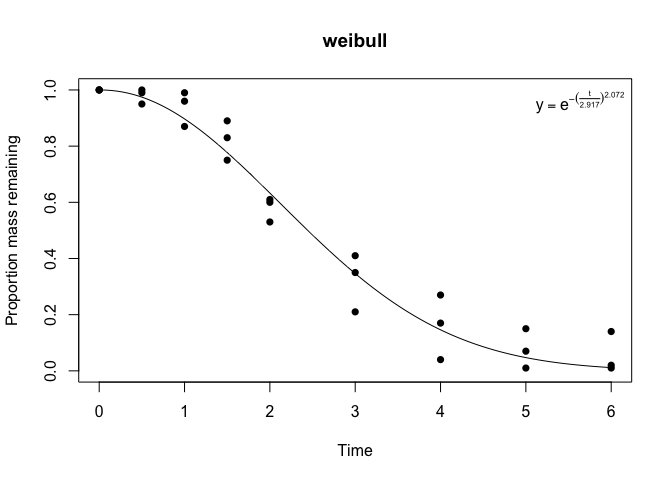
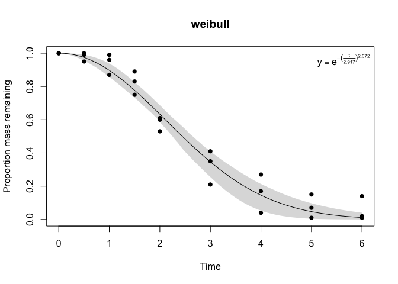
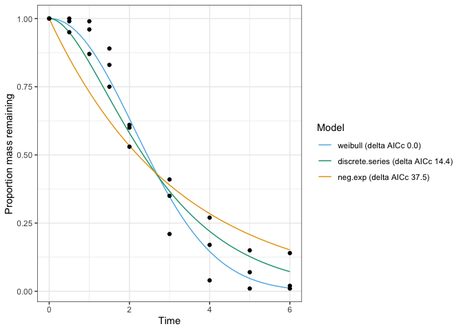

# litterfitter 

> R package for fitting and testing alternative models for single cohort
> litter decomposition data

### Installation

Install the released version from CRAN:

``` r

install.packages("litterfitter")
```

or the development version from GitHub:

``` r

# install.packages("remotes")
remotes::install_github("traitecoevo/litterfitter")
```

### Getting started

The key function is `fit_litter`, which can fit 6 different types of
decomposition trajectories. As a toy example, take a litterbag study
with three replicate bags harvested at each of nine times (in years).
Decomposition is slow at first, then speeds up, as often happens while
decomposers colonise the litter:

``` r

toy <- data.frame(
  time = rep(c(0, 0.5, 1, 1.5, 2, 3, 4, 5, 6), each = 3),
  mass.remaining = c(1, 1, 1, 1, 0.99, 0.95, 0.96, 0.87, 0.99,
                     0.75, 0.83, 0.89, 0.53, 0.6, 0.61, 0.41, 0.35, 0.21,
                     0.04, 0.27, 0.17, 0.01, 0.07, 0.15, 0.14, 0.01, 0.02)
)
```

Fit a Weibull curve to it. The fitted object is a `litfit` object:

``` r

fit <- fit_litter(
  time = toy$time,
  mass.remaining = toy$mass.remaining,
  model = "weibull",
  iters = 500
)

class(fit)
```

You can visually compare the fits of different non-linear equations with
the `plot_multiple_fits` function. The single-rate negative exponential
cannot capture the early lag that the Weibull curve fits:

``` r

plot_multiple_fits(
  time = toy$time,
  mass.remaining = toy$mass.remaining,
  model = c("neg.exp", "weibull"),
  iters = 500
)
```


Calling `plot` on a `litfit` object will show you the data, the curve
fit, and even the equation, with the estimated coefficients:

``` r

plot(fit)
```



The summary of a `litfit` object will show you some of the summary
statistics for the fit.

``` R
#> Summary of litFit object
#> Model type: weibull 
#> Number of observations:  27 
#> Parameter fit (beta): 2.92
#> Parameter fit (alpha): 2.07
#> Time to 50% mass loss: 2.44 
#> Implied steady state litter mass: 2.58 in units of yearly input 
#> AIC:  -65.1217 
#> AICc:  -64.6217 
#> BIC:  -62.53
```

Bootstrapping shows the uncertainty in the parameter estimates and in
the fitted curve:

``` r

boot <- bootstrap_parameters(fit, nboot = 500)
plot(fit, boot = boot)
```



### Comparing models and tidy output

[`fit_litter_all()`](https://traitecoevo.github.io/litterfitter/reference/fit_litter_all.md)
fits several models at once, and
[`glance()`](https://generics.r-lib.org/reference/glance.html) gives a
model comparison table.
[`tidy()`](https://generics.r-lib.org/reference/tidy.html),
[`glance()`](https://generics.r-lib.org/reference/glance.html) and
[`augment()`](https://generics.r-lib.org/reference/augment.html) return
results as data frames for further analysis or custom plots:

``` r

fits <- fit_litter_all(
  time = toy$time,
  mass.remaining = toy$mass.remaining,
  models = c("neg.exp", "weibull", "discrete.series"),
  iters = 500
)
glance(fits)[, c("fit", "nparams", "AICc", "delta_AICc", "time_to_50")]
#>               fit nparams      AICc delta_AICc time_to_50
#> 1         weibull       2 -64.62170    0.00000   2.444290
#> 2 discrete.series       3 -50.24970   14.37200   2.341991
#> 3         neg.exp       1 -27.15226   37.46945   2.206548
```

The Weibull model is strongly preferred here. The two-pool
`discrete.series` model can produce some lag, but it fits less well
despite having an extra parameter, and the single-rate `neg.exp` model
fits worst.

With ggplot2 installed,
[`autoplot()`](https://ggplot2.tidyverse.org/reference/autoplot.html)
draws fits, model comparisons and bootstrap distributions as ggplot
objects:

``` r

library(ggplot2)
autoplot(fits) + theme_bw()
```



### Element dynamics

[`fit_element()`](https://traitecoevo.github.io/litterfitter/reference/fit_element.md)
fits how the proportion of an element remaining (e.g. nitrogen) changes
as mass is lost, using the model of Parton et al. (2007). See the
vignette for details.
